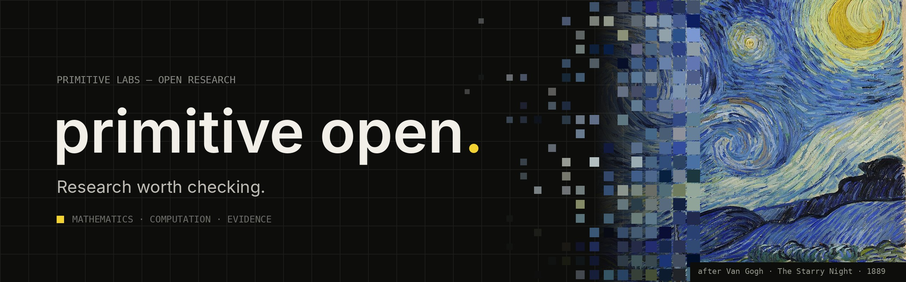
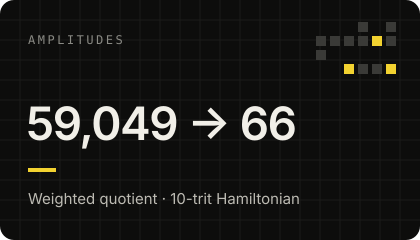
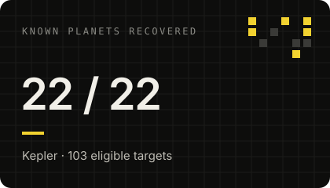
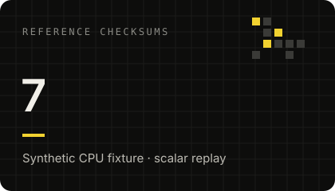
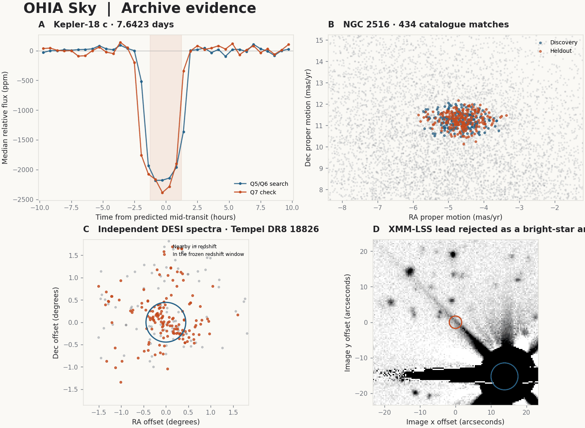
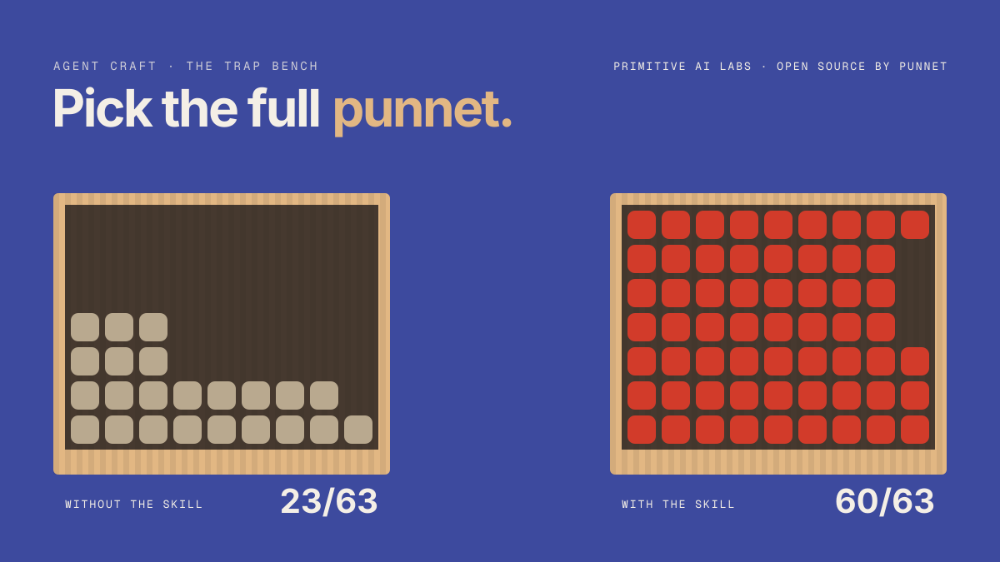

<p align="center">
  
</p>

<p align="center">
  Open research, reproducible experiments and practical tools from Primitive Labs, Australia.
</p>

<p align="center">
  <a href="LICENSE"></a>
  <a href="#research-catalogue"></a>
  <a href="docs/reproduce.md"></a>
</p>

<p align="center">
  <a href="#research-catalogue">Explore research</a> ·
  <a href="#start-with-a-check">Run a check</a> ·
  <a href="docs/reproduce.md">Reproduce responsibly</a> ·
  <a href="CONTRIBUTING.md">Contribute</a>
</p>

---

## What we're building

Primitive Open is the public home for selected research and tools from Primitive Labs. We investigate ways to represent, verify and compute information more efficiently, and publish the evidence needed to understand what a result does and does not establish.

**The principle is simple: make the claim inspectable.** A formal proof, a numerical comparison and a real-world observation are different kinds of evidence. We keep their boundaries explicit.

## Research catalogue

| Project | Explore | Evidence |
| :--- | :--- | :--- |
| **OHIA Sky** | [Astronomical archive study](research/ohia-sky/README.md) | [Evidence receipts](research/ohia-sky/evidence.json) · [Verifier](research/ohia-sky/verify.py) |
| **OHIA Sky · Round 3** | [Independent Kepler checks](research/ohia-sky/round-3/README.md) | [Lean source](research/ohia-sky/round-3/OhioSky.lean) · [Receipts](research/ohia-sky/round-3/public_receipts.json) |
| **Ohio · Weighted quotients** | [Symmetry-reduction research note](research/ohio-weighted-quotients-2026-11-17/PAPER.md) | [Lean source](research/ohio-weighted-quotients-2026-11-17/Ohio.lean) · [Experiment](research/ohio-weighted-quotients-2026-11-17/experiment.py) · [Verification](research/ohio-weighted-quotients-2026-11-17/VERIFICATION.md) |
| **Hardware verification** | [Synthetic CPU fixture](research/hardware-verification-2026-11-19/README.md) | [Reference verifier](research/hardware-verification-2026-11-19/verify.py) |

### Selected measured results

<table>
<tr>
<td width="33%" valign="top"><p>Weighted quotient representation for a synthetic symmetric 10-trit Hamiltonian. The recorded warm-kernel comparison is 325.33× against a full tensor implementation, excluding setup and I/O.</p><a href="research/ohio-weighted-quotients-2026-11-17/README.md">Read the scope and limits</a></td>
<td width="33%" valign="top"><p>Round 3 pooled and dense searches recovered the same 22 previously catalogued planets on 103 eligible Kepler targets. The pooled measured search stage used 8.39× less summed per-target time.</p><a href="research/ohia-sky/round-3/README.md">Read the experiment</a></td>
<td width="33%" valign="top"><p>A dependency-free scalar replay for checking synthetic CPU outputs. It is not an optimized GPU benchmark or a claim of independent replication.</p><a href="research/hardware-verification-2026-11-19/README.md">Run the fixture</a></td>
</tr>
</table>

The measurements above are scoped results from the respective research notes, not universal performance claims. The astronomical studies report no new planets or previously unknown astronomical objects. The published research is not presented as peer reviewed.

### From public astronomical archives

<p align="center"></p>

See the [OHIA Sky study](research/ohia-sky/README.md) for the methods, catalogue comparisons, limitations and full figure caption.

## Start with a check

Clone the repository:

```sh
git clone https://github.com/Primitivelabai/primitive-open.git
cd primitive-open
```

Use Python 3.9 or newer for the standard-library hardware fixture. The following checks reproduce selected published receipts or reference outputs, not the full original research pipeline:

```sh
(cd research/hardware-verification-2026-11-19 && python3 verify.py)
(cd research/ohia-sky && python3 verify.py)
(cd research/ohia-sky/round-3 && python3 verify_receipts.py)
```

For the weighted quotient numerical experiment and Lean checks, use the dependencies and pinned toolchains in the [project's reproduction instructions](research/ohio-weighted-quotients-2026-11-17/README.md). Preserve original result files before rerunning.

[Read the reproduction guide →](docs/reproduce.md)

## Skills and tools

<p align="center"><a href="agent-craft"></a></p>

**[agent craft](agent-craft)** is seven skills that stop AI agents making the mistakes that cost you: fake "done", skipped gates, leaky retrieval, untested UI, bad sums and briefs that can't be met.

```
npx skills add Primitivelabai/Primitive-open
```

On the trap bench, runs that dodged the trap went from 23/63 without the skills to 60/63 with them. That is a model-level comparison: each skill is given to the model in its prompt, and two blind judges score the answer. Native agent execution, where an agent must load the skill itself and act with real tools, is the next bench. Every case, answer and score is published in [agent-craft/bench](agent-craft/bench).

## Help us improve the evidence

Found an error, reproduced a result on a new machine, or identified a limitation? That is a useful contribution.

- [Open an issue](https://github.com/Primitivelabai/primitive-open/issues/new/choose) for a public correction, reproduction or proposal.
- Read the [contribution guide](CONTRIBUTING.md) and [reproduction guide](docs/reproduce.md).
- Follow the [security policy](SECURITY.md) for sensitive findings.

## Licence

Repository material is available under the [Apache License 2.0](LICENSE), subject to any explicit notices in individual components. External datasets and third-party material retain their own terms.

<p align="center"><sub>Primitive Labs · Australia · Open by evidence, not by assertion.</sub></p>
